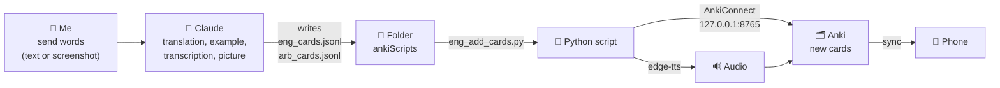
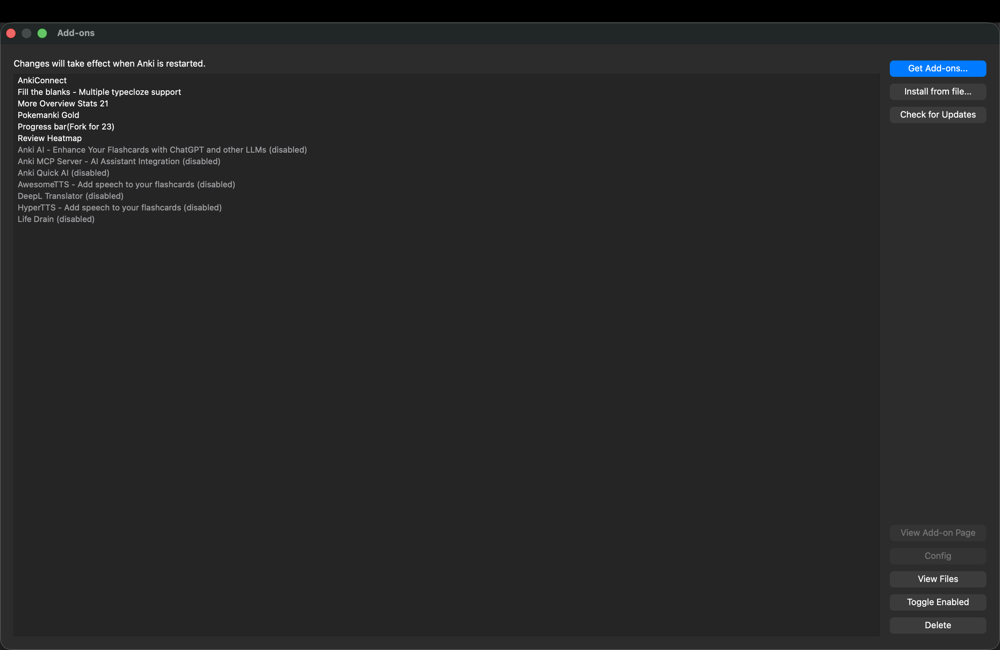
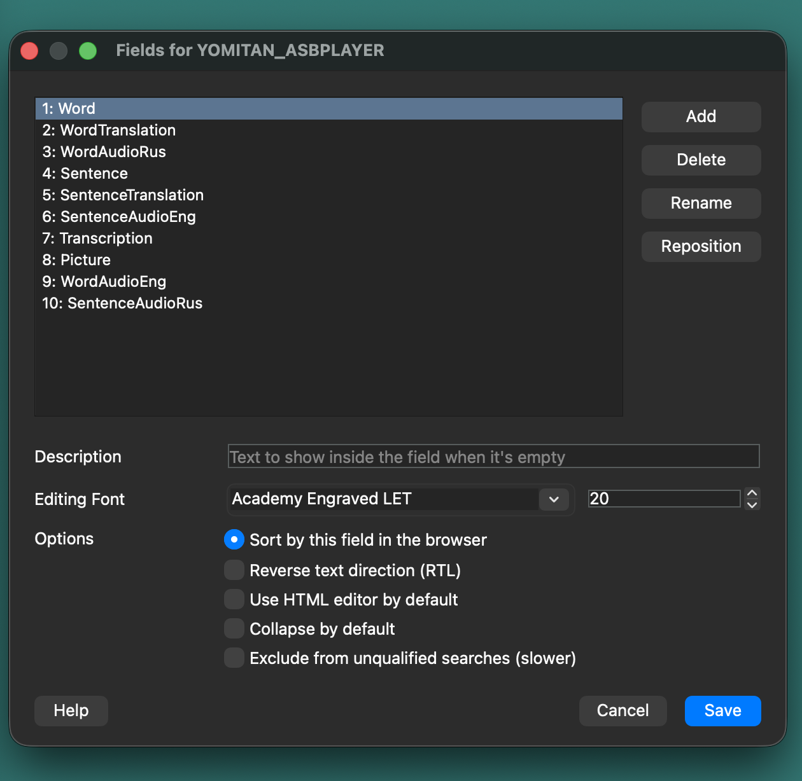
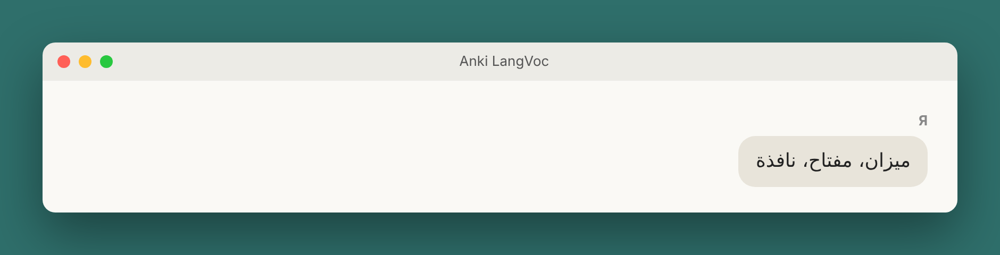
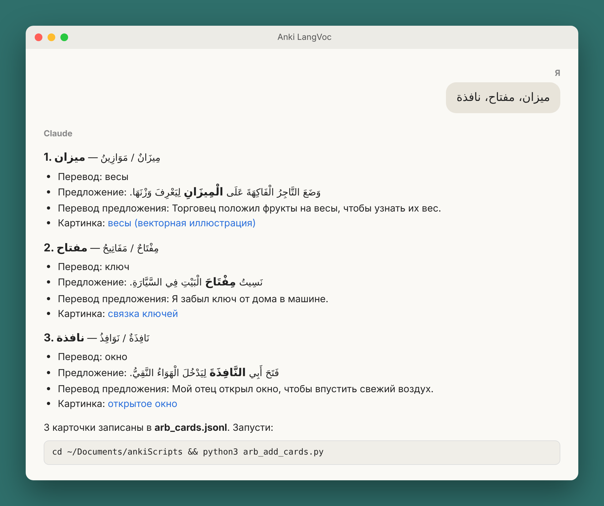
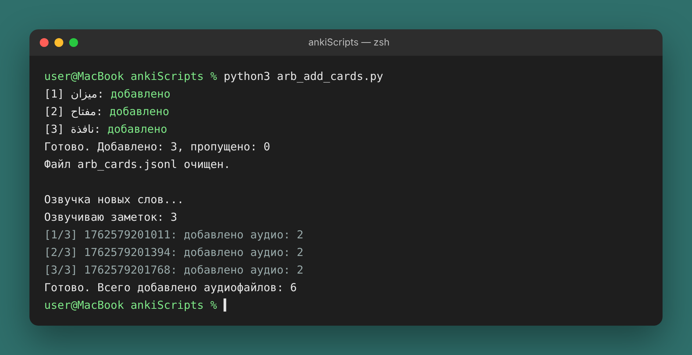
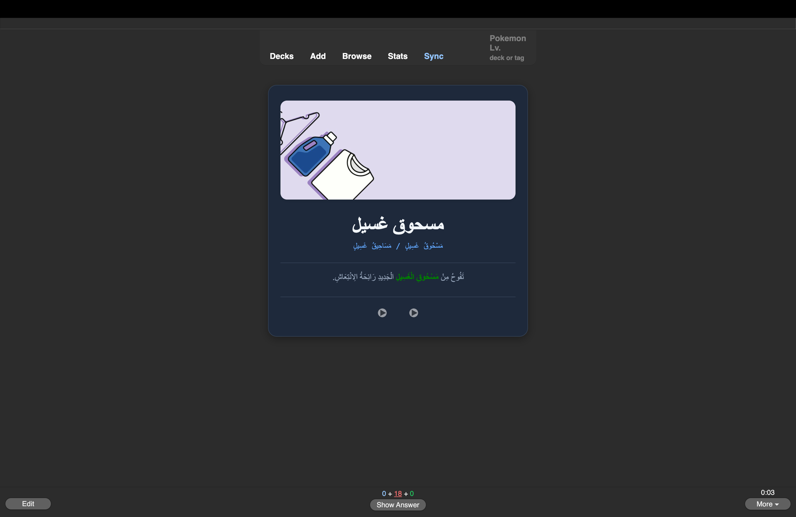
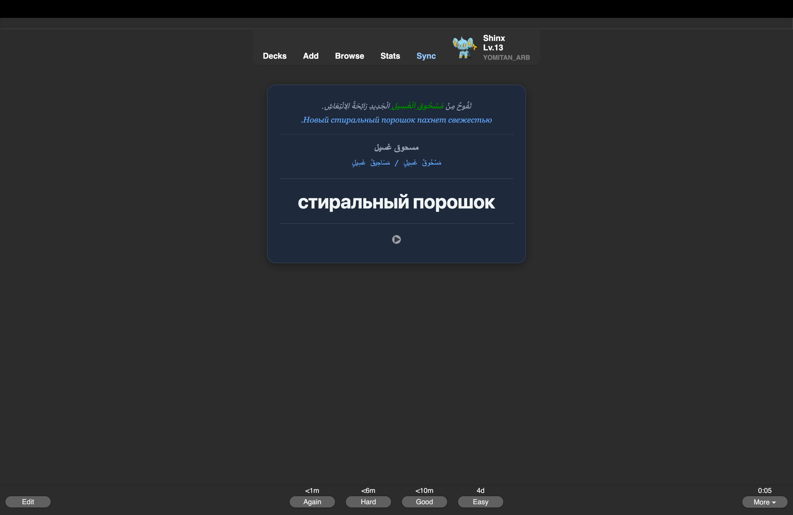

# 🧠 How I Automated Adding Words to Anki with Claude

English · **[العربية](README_ar.md)** · **[Русский](README_ru.md)**

What is the most important thing in a person's life? I think most people would say: time. It passes very quickly. What we spend our time on decides what we achieve, both in this world and in the next. So how do we manage our time wisely without wasting its precious minutes?

Adding a single word to my vocabulary used to take me several minutes, sometimes a full five: finding a picture, finding the pronunciation, finding an example, and so on. With automation and AI I made this much easier: in those same five minutes I now add 10–20 words, and the quality hasn't suffered at all.

That is what we'll look at today. Fortunately, our time has tools that make this easier. Today we'll go through a few tools that automate adding and memorizing words in our vocabulary bank.

> From "I sent a word in the chat" to a finished card with translation, example sentence, transcription, picture and audio, **with a single command**. Works on **macOS** and **Windows**.

Languages: **Arabic** and **English** (easy to add your own). Tools: **Claude**, **Anki** + **AnkiConnect**, **Python**, free text-to-speech via **edge-tts**, free images from **Unsplash**. No paid APIs.

---

## 📌 Contents

- [How it works](#-how-it-works)
- [Requirements](#-requirements)
- [Installation](#-installation)
  - [1. Download the repository](#1-download-the-repository)
  - [2. Install Python](#2-install-python)
  - [3. Install dependencies](#3-install-dependencies)
  - [4. Install Anki and AnkiConnect](#4-install-anki-and-ankiconnect)
  - [5. Set up Anki with one command](#5-set-up-anki-with-one-command)
  - [6. Connect the folder to Claude](#6-connect-the-folder-to-claude)
  - [7. Create a Project with instructions](#7-create-a-project-with-instructions)
- [Daily use](#-daily-use)
- [How the scripts work](#-how-the-scripts-work)
- [Troubleshooting](#-troubleshooting)
- [Results and takeaways](#-results-and-takeaways)

---

## 💡 How it works



| Who | What it does |
|---|---|
| Me | Sends the words and runs one command |
| Claude | The "thinking" part: translation, a B1–B2 example sentence, transcription, finding a picture. Writes everything to a file |
| Python script | The "mechanical" part: downloads the picture, creates the card in Anki, adds audio |
| Anki | Stores the cards and shows them with spaced repetition |

The key idea: **Claude never touches Anki directly**. It only writes a clean file into a shared folder, and a reliable script does the rest.

## 🧰 Requirements

| | macOS | Windows |
|---|---|---|
| Python 3.8+ | usually preinstalled | install from python.org |
| Anki | ✅ | ✅ |
| AnkiConnect | ✅ | ✅ |
| Claude desktop app | ✅ | ✅ |
| Python command | `python3` | `py` |
| Terminal | **Terminal** (Applications → Utilities) | **PowerShell** (Start → "PowerShell") |

---

## 🚀 Installation

### 1. Download the repository

On the repository page click the green **Code → Download ZIP** button.

1. Unzip the archive.
2. Rename the folder to **`ankiScripts`**.
3. Move it into your **Documents** folder:

| macOS | Windows |
|---|---|
| `/Users/<name>/Documents/ankiScripts` | `C:\Users\<name>\Documents\ankiScripts` |

> You can put it somewhere else, but then replace the path everywhere below (and in the Claude instructions).

<details>
<summary>With git (if you have it)</summary>

```bash
cd ~/Documents
git clone https://github.com/<your-username>/<repository-name>.git ankiScripts
```
</details>

### 2. Install Python

**macOS**: check in Terminal:

```bash
python3 --version
```

If it's 3.8 or newer, you're set. If the command isn't found, macOS will offer to install the developer tools, or download Python from <https://www.python.org/downloads/>.

**Windows**: download the installer from <https://www.python.org/downloads/>.
⚠️ On the first installer screen, tick **"Add python.exe to PATH"**. Then check in PowerShell:

```powershell
py --version
```

### 3. Install dependencies

Open a terminal **in the ankiScripts folder**:

**macOS**
```bash
cd ~/Documents/ankiScripts
python3 -m pip install -r requirements.txt
```

**Windows (PowerShell)**
```powershell
cd ~\Documents\ankiScripts
py -m pip install -r requirements.txt
```

Only one library is installed: `edge-tts` (free text-to-speech with Microsoft Edge voices). Everything else uses Python's standard library.

### 4. Install Anki and AnkiConnect

1. Download and install Anki: <https://apps.ankiweb.net/>
2. In Anki: **Tools → Add-ons → Get Add-ons…**
3. Enter the code **`2055492159`** (AnkiConnect) → **OK** → **restart Anki**.



AnkiConnect opens a local address, `http://127.0.0.1:8765`, which the scripts use to create cards. To check it, open that address in a browser while Anki is running; you should see `AnkiConnect v.6`.

### 5. Set up Anki with one command

`setup_anki.py` creates the **YOMITAN_ENG** and **YOMITAN_ARB** decks and the **YOMITAN_ASBPLAYER** note type with all the required fields. Anki must be open.

**macOS**
```bash
python3 setup_anki.py
```

**Windows**
```powershell
py setup_anki.py
```

```
Создан тип записи «YOMITAN_ASBPLAYER».
Создана колода «YOMITAN_ENG».
Создана колода «YOMITAN_ARB».

Готово! Теперь можно добавлять карточки (см. README).
```

(The scripts print messages in Russian: "Создана колода" = "deck created", "Готово" = "done".)

It's safe to run again: existing decks are left untouched.




> Want different deck names? Change `DECKS` in `setup_anki.py` and `DECK` at the top of the `*_add_cards.py` and `*_anki_tts.py` scripts.

### 6. Connect the folder to Claude

So that Claude can write the card files, give it access to the folder:

1. Open the **Claude** desktop app.
2. In the message box click **"+" → Add folder**.
3. Choose `Documents/ankiScripts`.


Claude will see **only this folder**, not your whole computer.

### 7. Create a Project with instructions

To avoid explaining the rules every time, create a **Project** in Claude (for example "Anki LangVoc") and paste the text from [`project_instructions.md`](project_instructions.md) into its **Instructions**.

At the top of that text there is a **"НАСТРОЙКА" (settings)** block: set your system (macOS or Windows) there so Claude gives you the right command. The instructions are written in Russian and cards are translated into Russian; you can change "на русский" to any language you like.

What the instructions define:

- cards are **not printed in the chat**; they're written to a `.jsonl` file (one line = one card);
- the language is detected from the word itself;
- field formats: IPA for English, full vowel marks for Arabic (`كَتَبَ – يَكْتُبُ`, `كِتَابٌ / كُتُبٌ`);
- a B1–B2 example sentence with the word highlighted in color;
- images only from Unsplash, and links are **never made up**.


✅ Installation complete.

---

## 📝 Daily use

**1. Send words** to the project chat, as text or a screenshot.


*(illustration)*


**2. Claude writes the file** and replies with a summary and the command.


*(illustration)*


An example line it writes (more in [`examples/`](examples/)):

```json
{"word": "imprudent", "translation": "неосторожный, неблагоразумный",
 "sentence": "It would be <b style=\"color:red\">imprudent</b> to spend all your savings on a car you don't really need.",
 "sentence_translation": "Было бы неблагоразумно тратить все сбережения на машину, которая тебе на самом деле не нужна.",
 "transcription": "/ɪmˈpruːdənt/",
 "image_url": "https://images.unsplash.com/photo-...?fm=jpg&q=70&w=800&auto=format&fit=crop"}
```

**3. Run the script** (with Anki open):

| | macOS | Windows (PowerShell) |
|---|---|---|
| English | `cd ~/Documents/ankiScripts && python3 eng_add_cards.py` | `cd ~\Documents\ankiScripts`<br/>`py eng_add_cards.py` |
| Arabic | `cd ~/Documents/ankiScripts && python3 arb_add_cards.py` | `cd ~\Documents\ankiScripts`<br/>`py arb_add_cards.py` |

```
[1] imperfect: добавлено
[2] improper: добавлено
Готово. Добавлено: 2, пропущено: 0
Файл eng_cards.jsonl очищен.

Озвучка новых слов...
Озвучиваю заметок: 2
Готово. Всего добавлено аудиофайлов: 4
```

("добавлено" = added, "очищен" = cleared, "аудиофайлов" = audio files.)



*(illustration)*

**4. Done**: the card is in Anki with a picture, example, transcription and audio. Sync Anki and it appears on your phone.





---

## ⚙️ How the scripts work

```
ankiScripts/
├── setup_anki.py          # run once: creates the decks and note type
├── eng_add_cards.py       # adds English cards and runs text-to-speech
├── eng_anki_tts.py        # adds audio to English cards
├── arb_add_cards.py       # same for Arabic
├── arb_anki_tts.py
├── eng_cards.jsonl        # ← Claude writes new words here (created automatically)
├── arb_cards.jsonl        # ←
├── requirements.txt       # edge-tts
├── project_instructions.md
├── examples/              # example card files
└── screenshots/
```

All paths in the scripts are **relative** (`Path(__file__)`): the scripts look for their files next to themselves, so the folder can live anywhere, on macOS or Windows.

**`*_add_cards.py`**
1. Checks that Anki is running.
2. Reads the `.jsonl` file line by line.
3. Downloads the picture and stores it in Anki's media library.
4. Creates the card and skips duplicates (if an existing card has no picture, it adds one).
5. Moves successful lines to the `*_cards_added.jsonl` archive; only failed lines stay in the file. The same word is never added twice.
6. Runs text-to-speech for the new cards only.

**`*_anki_tts.py`**
- Generates mp3 files with free Microsoft Edge voices (`en-US-AndrewNeural`, `ar-SA-HamedNeural`; change the voice at the top of the file).
- Fills **only empty** audio fields.
- For Arabic, `–` and `/` become a pause, so `كَتَبَ – يَكْتُبُ` is read as two forms.
- Can be run on its own to add audio to older cards: `python3 eng_anki_tts.py` (Windows: `py eng_anki_tts.py`).

All communication with Anki goes through one small function:

```python
def anki(action, **params):
    payload = json.dumps({"action": action, "version": 6, "params": params}).encode("utf-8")
    with urllib.request.urlopen(urllib.request.Request("http://127.0.0.1:8765", payload)) as resp:
        data = json.load(resp)
    if data.get("error"):
        raise RuntimeError(data["error"])
    return data["result"]
```

### Adding your own language

1. Copy `eng_add_cards.py` and `eng_anki_tts.py`, for example to `tur_add_cards.py` and `tur_anki_tts.py`.
2. In the copies, change `DECK`, the file name `eng_cards.jsonl` → `tur_cards.jsonl`, the name of the TTS script it calls, and the voice (list voices with `edge-tts --list-voices`).
3. Add the deck to `DECKS` in `setup_anki.py`, run it again, and add the new language's rules to the project instructions.

---

## 🛠 Troubleshooting

| Message | What to do |
|---|---|
| `Нет связи с AnkiConnect` (no connection to AnkiConnect) | Open Anki. Make sure AnkiConnect is installed and Anki was restarted after installing it |
| `Не установлена библиотека edge-tts` (edge-tts not installed) | Do step 3 |
| `python3: command not found` (Windows) | On Windows use `py` instead of `python3` |
| `py` not found (Windows) | Reinstall Python with "Add python.exe to PATH" ticked |
| `не удалось записать` (couldn't write) during TTS | Close Anki's card browser and edit windows, then run again |
| `картинка не скачалась` (picture didn't download) | The card is still added, just without a picture |
| `уже есть в колоде, пропущено` (already in deck, skipped) | The word was added earlier; nothing to fix |
| `&&` doesn't work in PowerShell | Run the commands separately: first `cd ...`, then `py ...` |

---

## 📊 Results and takeaways

| | By hand | Automated |
|---|---|---|
| Time per word | up to 5 minutes | seconds |
| 5 minutes of work | 1–2 words | 10–20 words |
| Audio | separate, manual | automatic |
| Pictures | manual search | Claude finds them on Unsplash |
| Quality | depends on how tired you are | consistent, follows the project rules |

**What I learned building this:**

1. **Split the work between AI and code.** AI is good at language (translations, examples, grammar); a script is good at repetitive mechanical steps.
2. **Use a simple exchange format.** `.jsonl` (one line = one card) is easy to check by eye and easy to process.
3. **Write the rules down once.** Project instructions turn Claude from a "chat" into a configured assistant.
4. **Guard against mistakes.** Duplicate checks, an archive of processed lines, and audio only for empty fields mean the script can be run any number of times.
5. **Give the least access needed.** Claude sees one folder, not the whole computer.

---

## 📄 License

[MIT](LICENSE): use it, change it and share it freely.
