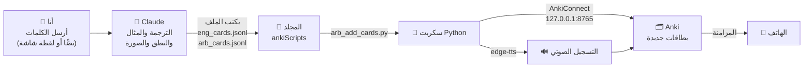
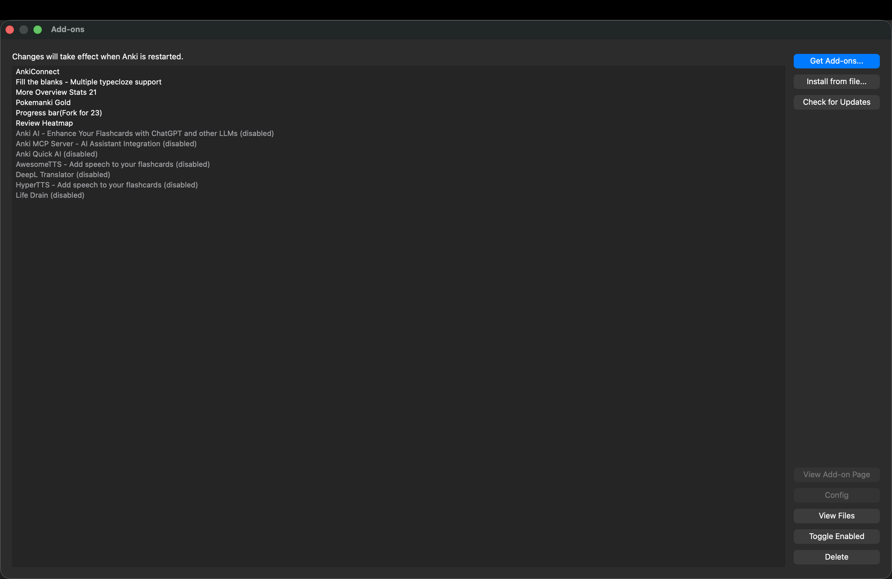
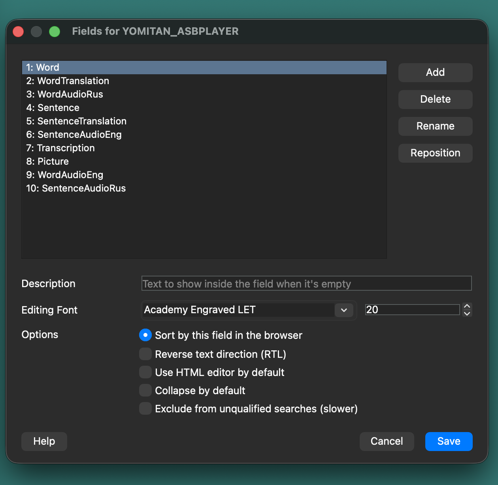
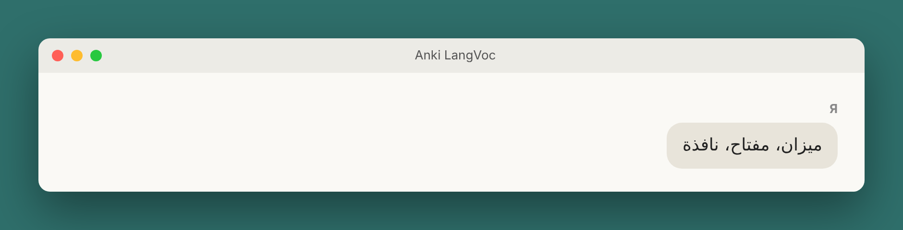
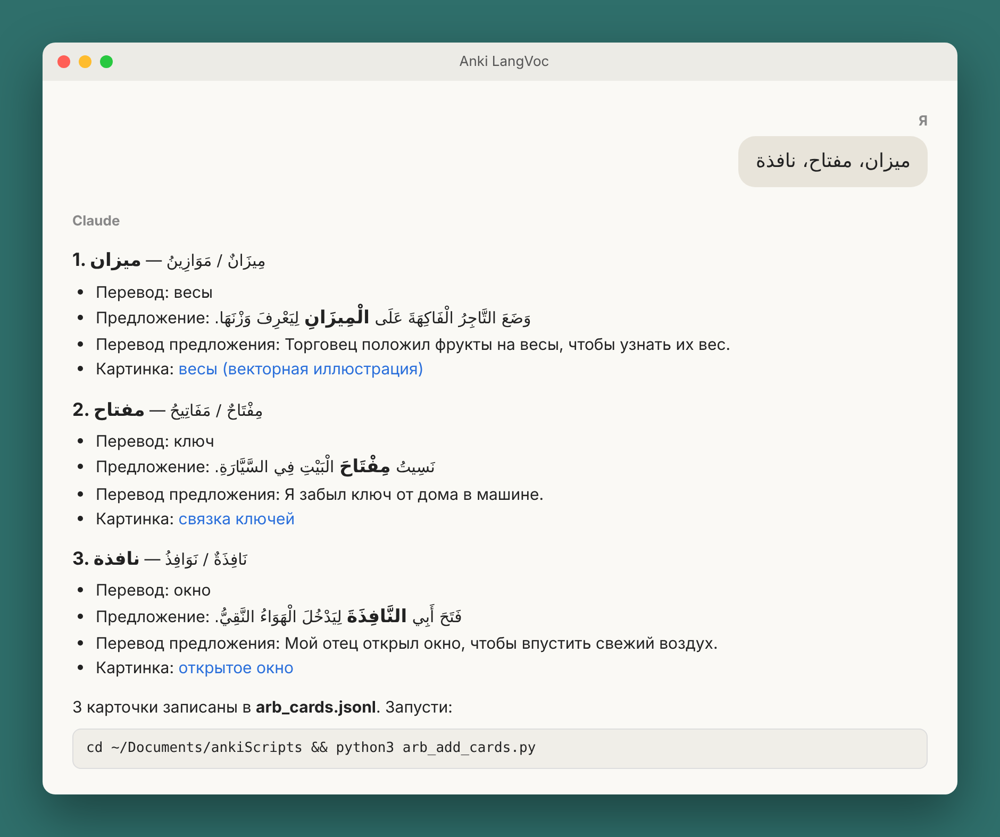
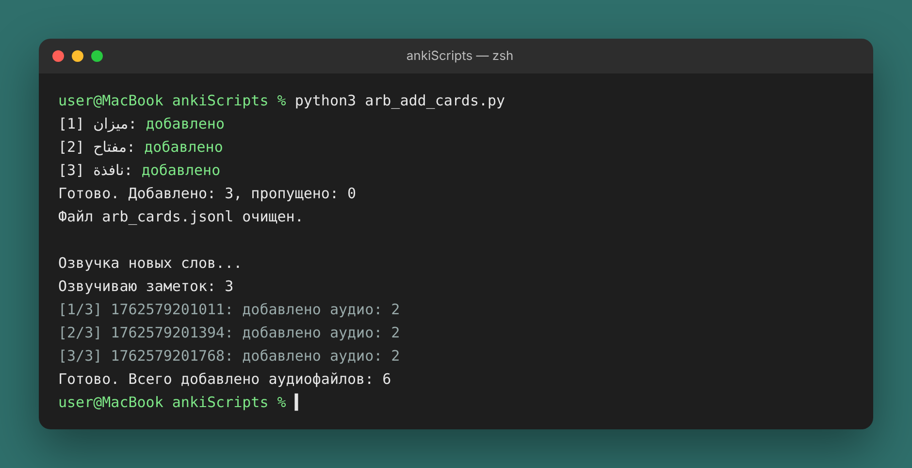
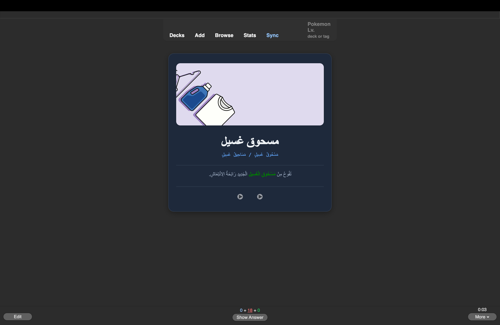

# 🧠 كيف أتمتُّ إضافة الكلمات إلى بطاقات Anki بمساعدة Claude

**[English](README.md)** · العربية · **[Русский](README_ru.md)**

ما أهمّ شيء في حياة الإنسان؟ أظنّ أنّ أكثر الناس سيجيبون: الوقت؛ لأنه يمضي سريعًا جدًّا. وعلى ما نُنفق فيه أوقاتنا يتوقّف ما نبلغه في هذه الدنيا وفي الآخرة. فكيف ندير أوقاتنا بحكمة دون أن نُضيّع دقائقها الثمينة؟

في السابق كانت إضافة كلمة واحدة إلى رصيدي اللغوي تستغرق مني عدة دقائق، وأحيانًا خمس دقائق كاملة: أبحث عن الصورة، ثم عن النطق، ثم عن مثال، وهكذا. أمّا الآن، وبفضل الأتمتة والذكاء الاصطناعي، فقد صرتُ أضيف في تلك الدقائق الخمس عشر كلمات إلى عشرين كلمة، دون أن تتأثر الجودة بشيء.

هذا ما سنتناوله اليوم. ومن نِعَم زماننا أنّ فيه أدوات تُيسّر علينا ذلك. سنستعرض اليوم عددًا من الأدوات التي تؤتمت إضافة الكلمات وحفظها في رصيدنا من المفردات.

> من «أرسلتُ كلمة في المحادثة» إلى بطاقة جاهزة فيها الترجمة والمثال والنطق والصورة والتسجيل الصوتي، **بأمر واحد**. يعمل على **macOS** و**Windows**.

اللغات: **العربية** و**الإنجليزية** (ويسهل إضافة لغتك). الأدوات: **Claude**، و**Anki** مع **AnkiConnect**، و**Python**، والتسجيل الصوتي المجاني **edge-tts**، والصور المجانية من **Unsplash**. بلا أي واجهات برمجية مدفوعة.

---

## 📌 المحتويات

1. كيف يعمل
2. ما الذي نحتاجه
3. التثبيت (7 خطوات)
4. الاستخدام اليومي
5. كيف تعمل السكربتات
6. مشكلات شائعة
7. النتيجة والخلاصة

---

## 💡 كيف يعمل



| مَن | ماذا يفعل |
|---|---|
| أنا | أرسل الكلمات وأشغّل أمرًا واحدًا |
| Claude | الجزء «الذكي»: الترجمة، ومثال بمستوى B1–B2، والنطق، والبحث عن صورة. ثم يكتب كل ذلك في ملف |
| سكربت Python | الجزء «الآلي»: تنزيل الصورة، وإنشاء البطاقة في Anki، والتسجيل الصوتي |
| Anki | يحفظ البطاقات ويعرضها وفق نظام التكرار المتباعد |

الفكرة الأساسية: **لا يدخل Claude إلى Anki مباشرة**. هو يكتب ملفًّا منظّمًا في المجلد المشترك فقط، وسكربت موثوق يتولى الباقي.

## 🧰 ما الذي نحتاجه

| | macOS | Windows |
|---|---|---|
| Python 3.8 أو أحدث | موجود عادةً | يُثبَّت من python.org |
| Anki | ✅ | ✅ |
| AnkiConnect | ✅ | ✅ |
| تطبيق Claude لسطح المكتب | ✅ | ✅ |
| أمر Python في الطرفية | `python3` | `py` |
| الطرفية | **Terminal** (التطبيقات ← الأدوات المساعدة) | **PowerShell** (ابدأ ← «PowerShell») |

---

## 🚀 التثبيت

### 1. تنزيل المستودع

في صفحة المستودع اضغط الزر الأخضر **Code ← Download ZIP**.

1. فُكّ ضغط الملف.
2. غيّر اسم المجلد الناتج إلى **`ankiScripts`**.
3. انقله إلى مجلد **المستندات (Documents)**:

| macOS | Windows |
|---|---|
| `/Users/<الاسم>/Documents/ankiScripts` | `C:\Users\<الاسم>\Documents\ankiScripts` |

> يمكنك وضعه في مكان آخر، لكن عندئذٍ استبدل المسار بمسارك في كل ما يلي (وفي تعليمات Claude).

<details>
<summary>عبر git (إن كان مثبّتًا لديك)</summary>

```bash
cd ~/Documents
git clone https://github.com/<اسم-المستخدم>/<اسم-المستودع>.git ankiScripts
```
</details>

### 2. تثبيت Python

**macOS**: تحقّق في Terminal:

```bash
python3 --version
```

إذا كان الإصدار 3.8 أو أعلى فكل شيء جاهز. وإن لم يُعثر على الأمر فسيعرض النظام تثبيت أدوات المطوّرين، أو نزّل Python من <https://www.python.org/downloads/>.

**Windows**: نزّل المثبّت من <https://www.python.org/downloads/>.
⚠️ في الشاشة الأولى من المثبّت ضع علامة على **«Add python.exe to PATH»**. ثم تحقّق في PowerShell:

```powershell
py --version
```

### 3. تثبيت المكتبات المطلوبة

افتح الطرفية **داخل مجلد ankiScripts**:

**macOS**
```bash
cd ~/Documents/ankiScripts
python3 -m pip install -r requirements.txt
```

**Windows (PowerShell)**
```powershell
cd ~\Documents\ankiScripts
py -m pip install -r requirements.txt
```

تُثبَّت مكتبة واحدة فقط هي `edge-tts` (تسجيل صوتي مجاني بأصوات Microsoft Edge). أما بقية السكربتات فتستخدم المكتبة القياسية لـ Python فقط.

### 4. تثبيت Anki وAnkiConnect

1. نزّل Anki وثبّته: <https://apps.ankiweb.net/>
2. في Anki: **Tools ← Add-ons ← Get Add-ons…**
3. أدخل الرمز **`2055492159`** ← **OK** ← **أعد تشغيل Anki**.



تفتح AnkiConnect عنوانًا محليًّا `http://127.0.0.1:8765` تُنشئ السكربتات البطاقات من خلاله. للتحقق افتح هذا العنوان في المتصفح وAnki يعمل، فيظهر `AnkiConnect v.6`.

### 5. إعداد Anki بأمر واحد

السكربت `setup_anki.py` ينشئ تلقائيًّا مجموعتَي البطاقات **YOMITAN_ENG** و**YOMITAN_ARB** ونوع الملاحظة **YOMITAN_ASBPLAYER** بكل الحقول المطلوبة. يجب أن يكون Anki مفتوحًا.

**macOS**
```bash
python3 setup_anki.py
```

**Windows**
```powershell
py setup_anki.py
```

```
Создан тип записи «YOMITAN_ASBPLAYER».
Создана колода «YOMITAN_ENG».
Создана колода «YOMITAN_ARB».

Готово! Теперь можно добавлять карточки (см. README).
```

(رسائل السكربتات بالروسية: «Создана колода» = أُنشئت المجموعة، «Готово» = تم.)

تشغيله مرة أخرى آمن: لا يمسّ المجموعات الموجودة.



> تريد أسماء أخرى للمجموعات؟ غيّر `DECKS` في `setup_anki.py` و`DECK` في أول السكربتات `*_add_cards.py` و`*_anki_tts.py`.

### 6. ربط المجلد بـ Claude

لكي يكتب Claude ملفات البطاقات، امنحه صلاحية الوصول إلى المجلد:

1. افتح تطبيق **Claude** على الحاسوب.
2. في خانة الرسالة اضغط **«+» ← Add folder**.
3. اختر المجلد `Documents/ankiScripts`.


سيرى Claude **هذا المجلد فقط**، لا الحاسوب كله.

### 7. إنشاء مشروع (Project) بالتعليمات

حتى لا تشرح القواعد في كل مرة، أنشئ في Claude **مشروعًا** (مثلًا «Anki LangVoc») والصق في خانة **Instructions** النصَّ الموجود في الملف [`project_instructions.md`](project_instructions.md).

في أول هذا النص قسم **«НАСТРОЙКА» (الإعداد)**: حدّد فيه نظامك (macOS أو Windows) ليعطيك Claude الأمر الصحيح.

ما تحدّده التعليمات:

- **لا تُعرض البطاقات في المحادثة**، بل تُكتب في ملف `.jsonl` (سطر واحد = بطاقة واحدة)؛
- تُحدَّد اللغة من الكلمة نفسها؛
- صيغة الحقول: رموز IPA للإنجليزية، والتشكيل الكامل للعربية (`كَتَبَ – يَكْتُبُ`، `كِتَابٌ / كُتُبٌ`)؛
- جملة بمستوى B1–B2 والكلمة فيها مميّزة بلون؛
- الصور من Unsplash فقط، ولا تُختلَق الروابط **أبدًا**.


✅ انتهى التثبيت.

---

## 📝 الاستخدام اليومي

**1. أرسل الكلمات** في محادثة المشروع، نصًّا أو لقطة شاشة:



**2. يكتب Claude الملف** ويرد بملخّص وأمر التشغيل:



مثال على سطر يكتبه (مزيد من الأمثلة في [`examples/`](examples/)):

```json
{"word": "بطريق", "translation": "пингвин",
 "sentence": "يَعِيشُ <b style=\"color:green\">الْبِطْرِيقُ</b> فِي الْمَنَاطِقِ الْبَارِدَةِ، وَهُوَ طَائِرٌ لَا يَطِيرُ لَكِنَّهُ يَسْبَحُ بِمَهَارَةٍ.",
 "sentence_translation": "Пингвин живёт в холодных краях; это птица, которая не летает, но умело плавает.",
 "transcription": "بِطْرِيقٌ / بَطَارِيقُ",
 "image_url": "https://images.unsplash.com/vector-...?fm=jpg&q=70&w=800&auto=format&fit=crop"}
```

(الترجمة في البطاقات إلى الروسية لأنها لغتي الأم، ويمكن تغييرها في التعليمات.)

**3. شغّل السكربت** (وAnki مفتوح):

| | macOS | Windows (PowerShell) |
|---|---|---|
| الإنجليزية | `cd ~/Documents/ankiScripts && python3 eng_add_cards.py` | `cd ~\Documents\ankiScripts`<br/>`py eng_add_cards.py` |
| العربية | `cd ~/Documents/ankiScripts && python3 arb_add_cards.py` | `cd ~\Documents\ankiScripts`<br/>`py arb_add_cards.py` |

```
[1] ديك رومي: добавлено
[2] بطريق: добавлено
Готово. Добавлено: 2, пропущено: 0
Файл arb_cards.jsonl очищен.

Озвучка новых слов...
Озвучиваю заметок: 2
Готово. Всего добавлено аудиофайлов: 4
```



**4. تمّ**: البطاقة في Anki فيها الصورة والمثال والنطق والتسجيل الصوتي. زامِن Anki لتظهر على الهاتف.



---

## ⚙️ كيف تعمل السكربتات

```
ankiScripts/
├── setup_anki.py          # مرة واحدة: ينشئ المجموعات ونوع الملاحظة
├── eng_add_cards.py       # يضيف البطاقات الإنجليزية ويشغّل التسجيل الصوتي
├── eng_anki_tts.py        # يسجّل نطق البطاقات الإنجليزية
├── arb_add_cards.py       # الشيء نفسه للعربية
├── arb_anki_tts.py
├── eng_cards.jsonl        # ← هنا يكتب Claude الكلمات الجديدة (يُنشأ تلقائيًّا)
├── arb_cards.jsonl        # ←
├── requirements.txt       # edge-tts
├── project_instructions.md
├── examples/              # أمثلة على ملفات البطاقات
└── screenshots/
```

كل المسارات في السكربتات **نسبية** (`Path(__file__)`): تبحث السكربتات عن ملفاتها بجانبها، لذا يمكن وضع المجلد في أي مكان، على الماك أو ويندوز.

**`*_add_cards.py`**
1. يتحقق من أن Anki يعمل.
2. يقرأ ملف `.jsonl` سطرًا سطرًا.
3. ينزّل الصورة ويضعها في مكتبة الوسائط في Anki.
4. ينشئ البطاقة ويتجاوز المكرّرات (وإذا كانت البطاقة الموجودة بلا صورة يضيفها).
5. ينقل الأسطر الناجحة إلى أرشيف `*_cards_added.jsonl` ولا يبقى في الملف إلا الأسطر الفاشلة. فلا تُضاف الكلمة نفسها مرتين أبدًا.
6. يشغّل التسجيل الصوتي للبطاقات الجديدة فقط.

**`*_anki_tts.py`**
- يولّد ملفات mp3 بأصوات Microsoft Edge المجانية (`en-US-AndrewNeural` و`ar-SA-HamedNeural`؛ ويمكن تغيير الصوت في أول الملف).
- يملأ حقول الصوت **الفارغة فقط**.
- في العربية تتحول `–` و`/` إلى وقفة، فتُقرأ `كَتَبَ – يَكْتُبُ` صيغتين متتاليتين.
- يمكن تشغيله وحده لتسجيل نطق البطاقات القديمة: `python3 arb_anki_tts.py` (في ويندوز: `py arb_anki_tts.py`).

كل التواصل مع Anki يتم عبر دالة صغيرة واحدة:

```python
def anki(action, **params):
    payload = json.dumps({"action": action, "version": 6, "params": params}).encode("utf-8")
    with urllib.request.urlopen(urllib.request.Request("http://127.0.0.1:8765", payload)) as resp:
        data = json.load(resp)
    if data.get("error"):
        raise RuntimeError(data["error"])
    return data["result"]
```

### إضافة لغة جديدة

1. انسخ `eng_add_cards.py` و`eng_anki_tts.py` باسمين جديدين، مثلًا `tur_add_cards.py` و`tur_anki_tts.py`.
2. غيّر في النسختين `DECK`، واسم الملف `eng_cards.jsonl` ← `tur_cards.jsonl`، واسم سكربت التسجيل الصوتي المستدعى، والصوت (قائمة الأصوات: `edge-tts --list-voices`).
3. أضف المجموعة إلى `DECKS` في `setup_anki.py` وشغّله مرة أخرى، ثم أضف قواعد اللغة الجديدة إلى تعليمات المشروع.

---

## 🛠 مشكلات شائعة

| الرسالة | الحل |
|---|---|
| `Нет связи с AnkiConnect` (لا اتصال بـ AnkiConnect) | افتح Anki. وتأكد من تثبيت AnkiConnect وإعادة تشغيل Anki بعد التثبيت |
| `Не установлена библиотека edge-tts` (المكتبة غير مثبّتة) | نفّذ الخطوة 3 |
| `python3: command not found` (ويندوز) | في ويندوز استخدم `py` بدل `python3` |
| الأمر `py` غير موجود (ويندوز) | أعد تثبيت Python مع علامة «Add python.exe to PATH» |
| `не удалось записать` (تعذّرت الكتابة) أثناء التسجيل الصوتي | أغلق نافذة متصفح البطاقات ونوافذ التحرير في Anki ثم أعد التشغيل |
| `картинка не скачалась` (لم تُنزَّل الصورة) | ستُضاف البطاقة على أي حال، لكن بلا صورة |
| `уже есть в колоде, пропущено` (موجودة من قبل) | الكلمة مضافة سابقًا، ولا مشكلة |
| `&&` لا يعمل في PowerShell | نفّذ الأمرين منفصلين: أولًا `cd ...` ثم `py ...` |

---

## 📊 النتيجة والخلاصة

| | يدويًّا | مع الأتمتة |
|---|---|---|
| الوقت لكلمة واحدة | حتى 5 دقائق | ثوانٍ |
| خمس دقائق من العمل | كلمة أو كلمتان | 10–20 كلمة |
| التسجيل الصوتي | منفصل ويدوي | تلقائي |
| الصور | بحث يدوي | يجدها Claude في Unsplash |
| الجودة | تتأثر بالتعب | ثابتة وفق قواعد المشروع |

**ما تعلّمته من هذا المشروع:**

1. **تقسيم العمل بين الذكاء الاصطناعي والكود.** الذكاء الاصطناعي بارع في اللغة (الترجمة والأمثلة والقواعد)، والسكربت بارع في الأعمال الآلية المتكررة.
2. **صيغة تبادل بسيطة.** ملف `.jsonl` (سطر = بطاقة) سهل المراجعة بالعين وسهل المعالجة.
3. **كتابة القواعد مرة واحدة.** تعليمات المشروع تحوّل Claude من «محادثة» إلى مساعد مُهيّأ.
4. **الحماية من الأخطاء.** التحقق من المكرّرات، وأرشفة الأسطر المعالَجة، والتسجيل الصوتي للحقول الفارغة فقط. لذلك يمكن تشغيل السكربت أي عدد من المرات.
5. **أقل صلاحيات ممكنة.** يرى Claude مجلدًا واحدًا فقط، لا الحاسوب كله.

---

## 📄 الترخيص

[MIT](LICENSE): استخدمه وعدّله وشاركه بحرية.
