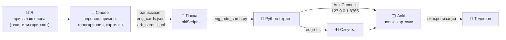
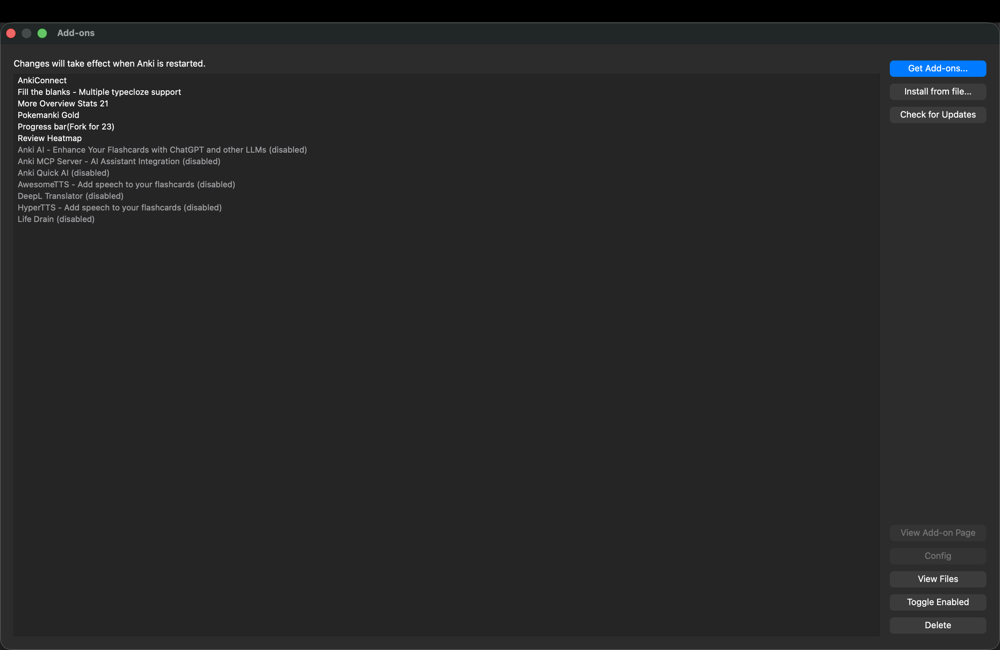
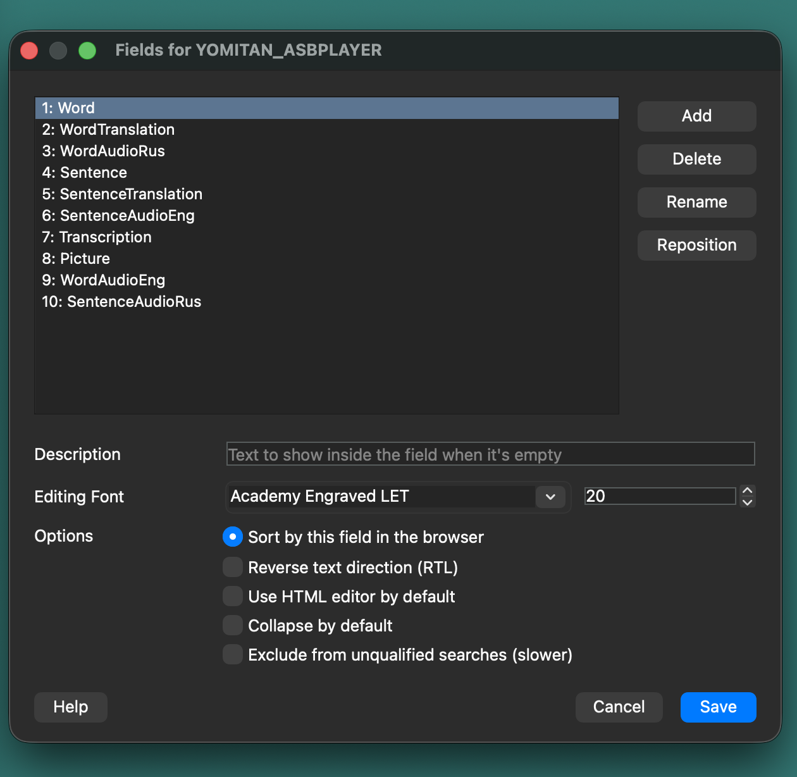
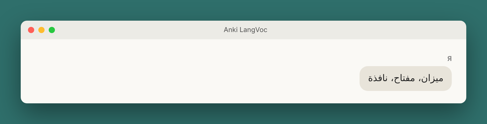
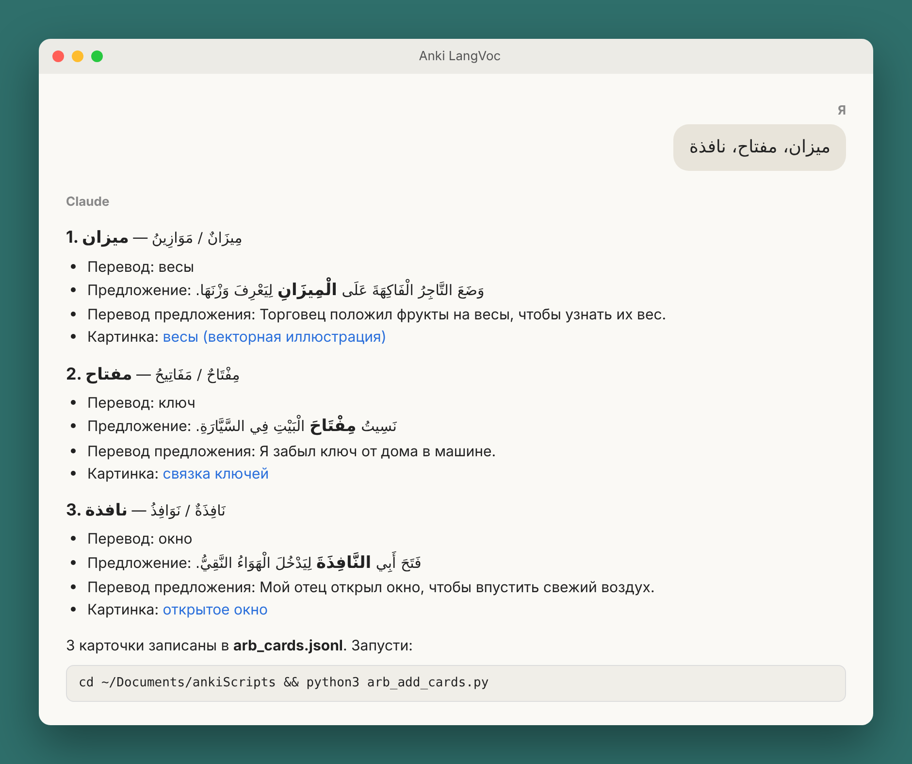
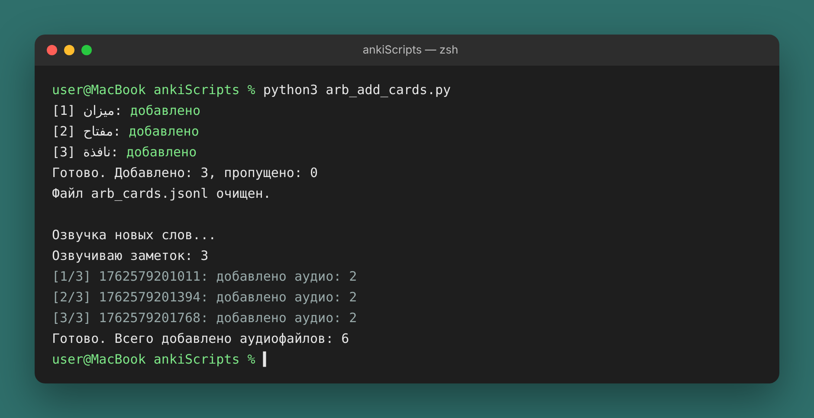
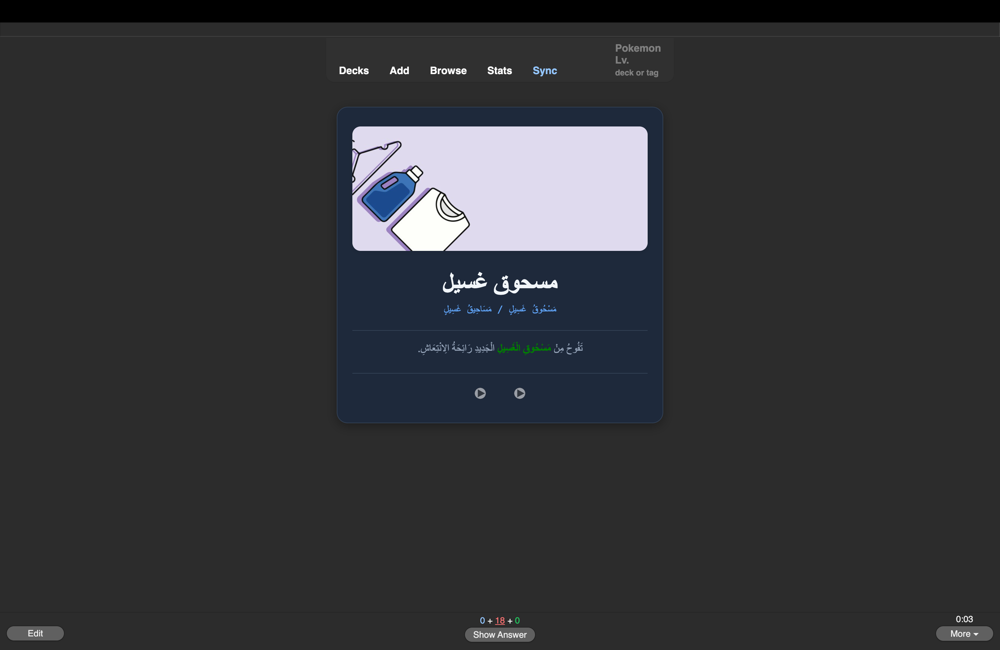
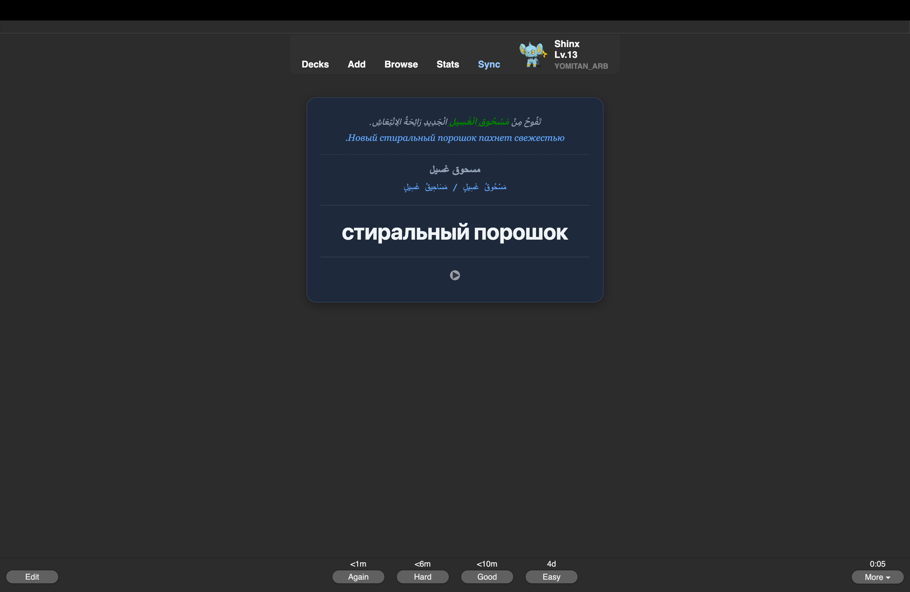

# 🧠 Как я автоматизировал пополнение Anki-колод с помощью Claude

**[English](README.md)** · **[العربية](README_ar.md)** · Русский

Что самое важное в жизни человека? Думаю, большинство ответят: время. Ведь оно протекает очень быстро. От того, на что мы тратим время, зависит, чего мы достигнем как в этом мире, так и в следующем. Так как же управлять своим временем с умом, не теряя его драгоценных минут?

Раньше, чтобы добавить одно слово в свой словарный запас, мне приходилось тратить на него несколько минут, а иногда и все пять: найти картинку, найти озвучку, подобрать пример и так далее. С помощью автоматизации и ИИ я облегчил себе эту задачу: теперь за те же пять минут я добавляю 10–20 слов, и качество при этом никак не страдает.

Сегодня мы это разберём. Благо в наше время есть инструменты, которые облегчают эту задачу. Сегодня мы разберём несколько инструментов, автоматизирующих добавление и заучивание слов в нашу словарную копилку.

> От «прислал слово в чат» до готовой карточки с переводом, примером, транскрипцией, картинкой и озвучкой — **одной командой**. Работает на **macOS** и **Windows**.

Языки: **арабский** и **английский** (легко добавить свой). Инструменты: **Claude**, **Anki** + **AnkiConnect**, **Python**, бесплатная озвучка **edge-tts**, бесплатные картинки **Unsplash**. Никаких платных API.

---

## 📌 Содержание

- [Как это работает](#-как-это-работает)
- [Что нужно](#-что-нужно)
- [Установка](#-установка)
  - [1. Скачать репозиторий](#1-скачать-репозиторий)
  - [2. Установить Python](#2-установить-python)
  - [3. Установить зависимости](#3-установить-зависимости)
  - [4. Установить Anki и AnkiConnect](#4-установить-anki-и-ankiconnect)
  - [5. Настроить Anki одной командой](#5-настроить-anki-одной-командой)
  - [6. Подключить папку к Claude](#6-подключить-папку-к-claude)
  - [7. Создать Project с инструкциями](#7-создать-project-с-инструкциями)
- [Ежедневное использование](#-ежедневное-использование)
- [Как устроены скрипты](#-как-устроены-скрипты)
- [Частые проблемы](#-частые-проблемы)
- [Результат и выводы](#-результат-и-выводы)

---

## 💡 Как это работает



| Кто | Что делает |
|---|---|
| Я | Присылаю слова и запускаю одну команду |
| Claude | «Думающая» часть: перевод, пример уровня B1–B2, транскрипция, поиск картинки. Записывает всё в файл |
| Python-скрипт | «Механическая» часть: скачивает картинку, создаёт карточку в Anki, озвучивает |
| Anki | Хранит карточки и показывает их по интервальному повторению |

Главная идея: **Claude не лезет в Anki напрямую**. Он только пишет аккуратный файл в общую папку, а надёжный скрипт делает остальное.

## 🧰 Что нужно

| | macOS | Windows |
|---|---|---|
| Python 3.8+ | обычно уже есть | ставится с python.org |
| Anki | ✅ | ✅ |
| AnkiConnect | ✅ | ✅ |
| Приложение Claude для компьютера | ✅ | ✅ |
| Команда Python в терминале | `python3` | `py` |
| Терминал | **Терминал** (Программы → Утилиты) | **PowerShell** (Пуск → «PowerShell») |

---

## 🚀 Установка

### 1. Скачать репозиторий

На странице репозитория нажмите зелёную кнопку **Code → Download ZIP**.

1. Распакуйте архив.
2. Переименуйте получившуюся папку в **`ankiScripts`**.
3. Переместите её в папку **Документы**:

| macOS | Windows |
|---|---|
| `/Users/<имя>/Documents/ankiScripts` | `C:\Users\<имя>\Documents\ankiScripts` |

> Можно положить и в другое место, но тогда везде ниже (и в инструкциях для Claude) замените путь на свой.

<details>
<summary>Через git (если он у вас есть)</summary>

```bash
cd ~/Documents
git clone https://github.com/<ваш-логин>/<название-репозитория>.git ankiScripts
```
</details>

### 2. Установить Python

**macOS** — проверьте в Терминале:

```bash
python3 --version
```

Если версия 3.8 или выше — всё готово. Если команда не найдена, macOS сама предложит установить инструменты разработчика, или скачайте Python с <https://www.python.org/downloads/>.

**Windows** — скачайте установщик с <https://www.python.org/downloads/>.
⚠️ На первом экране установщика поставьте галочку **«Add python.exe to PATH»**. Затем проверьте в PowerShell:

```powershell
py --version
```

### 3. Установить зависимости

Откройте терминал **в папке ankiScripts**:

**macOS**
```bash
cd ~/Documents/ankiScripts
python3 -m pip install -r requirements.txt
```

**Windows (PowerShell)**
```powershell
cd ~\Documents\ankiScripts
py -m pip install -r requirements.txt
```

Ставится одна библиотека — `edge-tts` (бесплатная озвучка голосами Microsoft Edge). Остальные скрипты используют только стандартную библиотеку Python.

### 4. Установить Anki и AnkiConnect

1. Скачайте и установите Anki: <https://apps.ankiweb.net/>
2. В Anki: **Инструменты → Дополнения → Получить дополнения…** (Tools → Add-ons → Get Add-ons…)
3. Введите код **`2055492159`** → **OK** → **перезапустите Anki**.



AnkiConnect открывает локальный адрес `http://127.0.0.1:8765`, через который скрипты создают карточки. Чтобы проверить, откройте этот адрес в браузере при запущенном Anki — должно появиться `AnkiConnect v.6`.

### 5. Настроить Anki одной командой

Скрипт `setup_anki.py` сам создаст колоды **YOMITAN_ENG**, **YOMITAN_ARB** и тип записи **YOMITAN_ASBPLAYER** со всеми нужными полями. Anki должен быть открыт.

**macOS**
```bash
python3 setup_anki.py
```

**Windows**
```powershell
py setup_anki.py
```

```
Создан тип записи «YOMITAN_ASBPLAYER».
Создана колода «YOMITAN_ENG».
Создана колода «YOMITAN_ARB».

Готово! Теперь можно добавлять карточки (см. README).
```

Запускать повторно безопасно: существующие колоды он не трогает.




> Хотите свои названия колод? Поменяйте `DECKS` в `setup_anki.py` и `DECK` в начале скриптов `*_add_cards.py` и `*_anki_tts.py`.

### 6. Подключить папку к Claude

Чтобы Claude мог записывать файлы с карточками, дайте ему доступ к папке:

1. Откройте приложение **Claude** на компьютере.
2. В поле сообщения нажмите **«+» → Add folder**.
3. Выберите папку `Documents/ankiScripts`.


Claude будет видеть **только эту папку**, а не весь компьютер.

### 7. Создать Project с инструкциями

Чтобы не объяснять правила каждый раз, создайте в Claude **Project** (например, «Anki LangVoc») и вставьте в его **Instructions** текст из файла [`project_instructions.md`](project_instructions.md).

В начале этого текста есть блок **«НАСТРОЙКА»**: укажите там свою систему (macOS или Windows), чтобы Claude давал правильную команду.

Что задают инструкции:

- карточки **не выводятся в чат**, а записываются в `.jsonl`-файл (одна строка = одна карточка);
- язык определяется по самому слову;
- формат полей: IPA для английского, полные огласовки для арабского (`كَتَبَ – يَكْتُبُ`, `كِتَابٌ / كُتُبٌ`);
- предложение уровня B1–B2, слово в нём выделено цветом;
- картинки только с Unsplash, ссылки **никогда не выдумываются**.


✅ Установка закончена.

---

## 📝 Ежедневное использование

**1. Пришлите слова** в чат проекта — текстом или скриншотом.


*(иллюстрация)*


**2. Claude запишет файл** и ответит сводкой с командой.


*(иллюстрация)*


Пример строки, которую он пишет (больше — в [`examples/`](examples/)):

```json
{"word": "imprudent", "translation": "неосторожный, неблагоразумный",
 "sentence": "It would be <b style=\"color:red\">imprudent</b> to spend all your savings on a car you don't really need.",
 "sentence_translation": "Было бы неблагоразумно тратить все сбережения на машину, которая тебе на самом деле не нужна.",
 "transcription": "/ɪmˈpruːdənt/",
 "image_url": "https://images.unsplash.com/photo-...?fm=jpg&q=70&w=800&auto=format&fit=crop"}
```

**3. Запустите скрипт** (Anki открыт):

| | macOS | Windows (PowerShell) |
|---|---|---|
| Английский | `cd ~/Documents/ankiScripts && python3 eng_add_cards.py` | `cd ~\Documents\ankiScripts`<br/>`py eng_add_cards.py` |
| Арабский | `cd ~/Documents/ankiScripts && python3 arb_add_cards.py` | `cd ~\Documents\ankiScripts`<br/>`py arb_add_cards.py` |

```
[1] imperfect: добавлено
[2] improper: добавлено
Готово. Добавлено: 2, пропущено: 0
Файл eng_cards.jsonl очищен.

Озвучка новых слов...
Озвучиваю заметок: 2
Готово. Всего добавлено аудиофайлов: 4
```



*(иллюстрация)*

**4. Готово** — карточка в Anki с картинкой, примером, транскрипцией и озвучкой. Синхронизируйте Anki, и она появится на телефоне.





---

## ⚙️ Как устроены скрипты

```
ankiScripts/
├── setup_anki.py          # один раз: создаёт колоды и тип записи
├── eng_add_cards.py       # добавляет английские карточки + запускает озвучку
├── eng_anki_tts.py        # озвучивает английские карточки
├── arb_add_cards.py       # то же для арабского
├── arb_anki_tts.py
├── eng_cards.jsonl        # ← сюда Claude пишет новые слова (создаётся сам)
├── arb_cards.jsonl        # ←
├── requirements.txt       # edge-tts
├── project_instructions.md
├── examples/              # примеры файлов с карточками
└── screenshots/
```

Все пути в скриптах **относительные** (`Path(__file__)`): скрипты ищут свои файлы рядом с собой, поэтому папка может лежать где угодно — на Mac или Windows.

**`*_add_cards.py`**
1. Проверяет, что Anki запущен.
2. Читает `.jsonl` построчно.
3. Скачивает картинку и кладёт её в медиатеку Anki.
4. Создаёт карточку; дубликаты пропускает (а если у существующей карточки нет картинки — добавляет её).
5. Успешные строки переносит в архив `*_cards_added.jsonl`, в файле остаются только ошибочные. Одно слово никогда не добавится дважды.
6. Запускает озвучку только для новых карточек.

**`*_anki_tts.py`**
- Генерирует mp3 бесплатными голосами Microsoft Edge (`en-US-AndrewNeural`, `ar-SA-HamedNeural`; голос можно поменять в начале файла).
- Заполняет **только пустые** аудиополя.
- Для арабского `–` и `/` превращаются в паузу, чтобы `كَتَبَ – يَكْتُبُ` читалось как две формы.
- Можно запустить отдельно, чтобы озвучить старые карточки: `python3 eng_anki_tts.py` (Windows: `py eng_anki_tts.py`).

Всё общение с Anki идёт через одну маленькую функцию:

```python
def anki(action, **params):
    payload = json.dumps({"action": action, "version": 6, "params": params}).encode("utf-8")
    with urllib.request.urlopen(urllib.request.Request("http://127.0.0.1:8765", payload)) as resp:
        data = json.load(resp)
    if data.get("error"):
        raise RuntimeError(data["error"])
    return data["result"]
```

### Добавить свой язык

1. Скопируйте `eng_add_cards.py` и `eng_anki_tts.py`, например, в `tur_add_cards.py` и `tur_anki_tts.py`.
2. В копиях поменяйте `DECK`, имя файла `eng_cards.jsonl` → `tur_cards.jsonl`, имя вызываемого TTS-скрипта и голос (список голосов: `edge-tts --list-voices`).
3. Добавьте колоду в `DECKS` в `setup_anki.py`, запустите его ещё раз и допишите правила нового языка в инструкции проекта.

---

## 🛠 Частые проблемы

| Сообщение | Что делать |
|---|---|
| `Нет связи с AnkiConnect` | Откройте Anki. Проверьте, что AnkiConnect установлен и Anki перезапущен после установки |
| `Не установлена библиотека edge-tts` | Выполните шаг 3 |
| `python3: command not found` (Windows) | На Windows используйте `py` вместо `python3` |
| `py` не найден (Windows) | Переустановите Python с галочкой «Add python.exe to PATH» |
| `не удалось записать` при озвучке | Закройте в Anki окно браузера карточек и окна редактирования, запустите снова |
| `картинка не скачалась` | Карточка всё равно добавится, просто без картинки |
| `уже есть в колоде, пропущено` | Это слово уже добавлено раньше — всё нормально |
| `&&` не работает в PowerShell | Выполните команды по отдельности: сначала `cd ...`, потом `py ...` |

---

## 📊 Результат и выводы

| | Вручную | С автоматизацией |
|---|---|---|
| Время на 1 слово | до 5 минут | секунды |
| 5 минут работы | 1–2 слова | 10–20 слов |
| Озвучка | отдельно, вручную | автоматически |
| Картинки | поиск вручную | Claude находит на Unsplash |
| Качество | зависит от усталости | одинаковое, по правилам проекта |

**Что я понял, пока делал этот проект:**

1. **Делить работу между ИИ и кодом.** ИИ хорош в языке (переводы, примеры, грамматика), скрипт — в повторяемых механических действиях.
2. **Простой формат обмена.** `.jsonl` (одна строка = одна карточка) легко проверить глазами и легко обработать.
3. **Правила записать один раз.** Инструкции проекта превращают Claude из «чата» в настроенного помощника.
4. **Защита от ошибок.** Проверка дубликатов, архив обработанных строк, озвучка только пустых полей — скрипт можно запускать сколько угодно раз.
5. **Доступ по минимуму.** Claude видит только одну папку, а не весь компьютер.

---

## 📄 Лицензия

[MIT](LICENSE) — используйте, меняйте и делитесь свободно.
